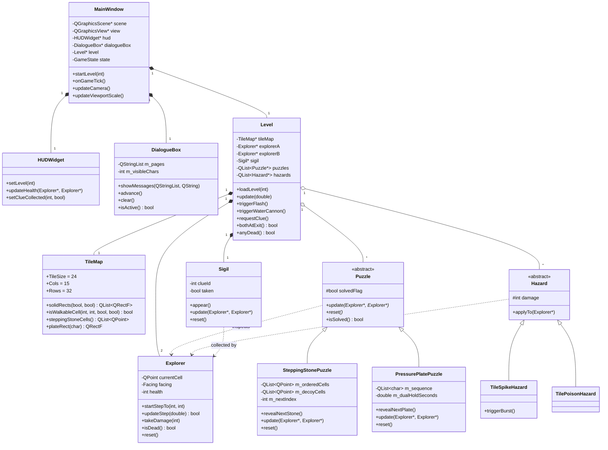

# Ruins of the Unown

A two-player cooperative top-down puzzle adventure written in **C++17** with **Qt 6 (Widgets)**, built for the *CSCE 1102 – Fundamentals of Computing II* course project (AUC, Fall 2026).

Two trainers share one keyboard to explore a tile-based ruin, survive environmental hazards, combine asymmetric Pokémon companion abilities (**Flash** and **Water Cannon**), and collect **Sigils** to unlock the exit. The architecture separates rendering and screen-space overlays (`MainWindow`, `HUDWidget`, `DialogueBox`) from level simulation, grid collision, hazards, and polymorphic puzzle state machines (`Level`, `TileMap`, `Explorer`, `Puzzle`, `Hazard`, `Sigil`).

## Features

**Milestone 1 & Level 1 v2 (implemented)**

| Feature | How to use it |
| --- | --- |
| Two-player grid movement | **Trainer 1 (Green):** `W` `A` `S` `D` · **Trainer 2 (Blue):** `Up` `Left` `Down` `Right` (`24 × 24` px smooth tile steps with held-key repeat) |
| Viewport & vertical camera | `15 × 10` tile logical viewport (`360 × 240` px) scaled at `3×` (`1080 × 720` px) with nearest-neighbor filtering; camera tracks the northernmost trainer |
| **Flash** (`E`) | Trainer 1 illuminates the next required stepping stone in Area 1 or the next Unown rune plate in Area 2 |
| **Water Cannon** (`Enter`) | Trainer 2 fires a directional water jet (`3` tiles) to clear the weakened boulder gate once Sigil 1 is collected |
| Area 1 — Stepping Stones | Trainer 2 steps on stones `1 → 2 → 3 → 4 → 5` in sequence while avoiding decoy stones and purple poison spills to unseal the rock entrance |
| Area 2 — Rune & Final Plates | Trainer 2 activates Unown plates `c → a → e` without triggering floor spikes; both trainers then hold the two golden plates for `3.0 s` to summon **Sigil 1** |
| Dialogue box & clues (`H`) | FireRed-style typewriter dialogue pauses gameplay on area and gate triggers; press `H` anytime for a context-aware hint (`Space` / `Enter` / `E` / click to advance) |
| HUD & two-tier clue persistence | Displays both trainers' HP bars, current level, and 5 sigil slots; dying restarts the current level while preserving sigils from prior levels |

**Milestone 2 (planned / upcoming):** Legacy Milestone 1 file cleanup (`World`, `AltarPuzzle`, `LetterTrailPuzzle`), Levels 2–5 with moving hazards/guardians, 4+ puzzle mechanics, main menu and level select, and persistent progress via `save.txt`.

## Architecture

`MainWindow` manages the Qt `GameState` machine, integer viewport scaling, vertical camera tracking, and screen-space overlays (`HUDWidget`, `DialogueBox`), delegating simulation ticks and input state to `Level`. `Level` coordinates `TileMap`, `Explorer` grid movement, polymorphic `Puzzle` subclasses, `Hazard` items, and `Sigil` collection via Qt signals and slots.



| Class | Responsibility |
| --- | --- |
| `MainWindow` | Owns `QGraphicsScene`/`QGraphicsView`, `HUDWidget`, `DialogueBox`, timers, and the `GameState` machine (`Title → Playing → LevelComplete → NextLevelStub`). Runs the 16 ms tick loop, enforces death-before-exit checks, and updates integer viewport scaling and vertical camera tracking. |
| `HUDWidget` | Mouse-transparent top status bar displaying both trainers' health bars, the current level label, and 5 sigil slots. |
| `DialogueBox` | FireRed-style double-bordered dialogue overlay with a 24 ms typewriter timer, speaker badge, and blinking advance prompt; pauses gameplay while open. |
| `Level` | Builds the active Level 1 map, manages input state, grid movement collision queries, Flash and Water Cannon abilities, entrance/gate states, and one-shot story/clue triggers. |
| `TileMap` | Parses `level1.txt` (`15 × 32` grid) and `tileset.json`, renders 4-bit cardinal autotiled walls, floor variants, and decorative rocks, and exposes puzzle and gate coordinates. |
| `Explorer` | Represents a trainer (`32 × 32` v2 sprite sheet on a `24 × 24` grid cell) with 4-direction walk animation, smooth tile-to-tile interpolation, health, and post-hit invulnerability frames. |
| `Puzzle` | Abstract base class defining `update(Explorer*, Explorer*)`, `reset()`, and the `solved()` signal. Implemented by `SteppingStonePuzzle` (Area 1) and `PressurePlatePuzzle` (Area 2). |
| `Hazard` | Base `QGraphicsRectItem` for contact damage (`10` HP spikes, `5` HP poison), extended by animated `TileSpikeHazard` and `TilePoisonHazard`. |
| `Sigil` | Animated 4-frame collectible clue (`sigil_light.png`) hidden until `appear()` is triggered by solving Area 2's final plates; emits `collected(clueId)` to weaken the boulder gate and update the HUD. |

### Gameplay & Puzzle Workflow

1. Clicking the title banner transitions `MainWindow` from `Title` to `Playing` and calls `Level::loadLevel(1)`, spawning `TileMap`, both `Explorer` instances, puzzles, hazards, and `Sigil 1`.
2. Every `16 ms` tick (`MainWindow::onGameTick`), if `DialogueBox` is inactive, `Level::update(dt)` advances grid steps, updates ability VFX, checks hazard collisions, updates `SteppingStonePuzzle` / `PressurePlatePuzzle` / `Sigil`, and triggers one-shot area dialogues.
3. Solving `SteppingStonePuzzle` emits `Puzzle::solved` → `Level::openEntrance()`, unsealing the Area 1–2 rock wall.
4. Solving `PressurePlatePuzzle` (rune sequence `c → a → e` + 3-second dual hold on the final plates) emits `Puzzle::solved` → `Sigil::appear()`.
5. Touching `Sigil 1` emits `Sigil::collected(1)` → `MainWindow::onClueCollected(1)` (HUD slot 1) and `Level::weakenGate()`.
6. Firing **Water Cannon** (`Enter`) from Trainer 2 clears the weakened gate (`Level::triggerWaterCannon()`), allowing `Level::bothAtExit()` to return `true` when both trainers enter the northern passage.

## Project structure

```text
.
├── RuinsOfTheUnown.pro              # qmake build configuration (C++17, Qt Widgets)
├── resources.qrc                    # Embedded sprites, tileset, and level1.txt layout
├── main.cpp                         # Application entry point
├── mainwindow.{h,cpp,ui}            # Game window, state machine, camera, input routing
├── HUDWidget.{h,cpp}                # Screen-space top HUD overlay
├── DialogueBox.{h,cpp}              # Typewriter dialogue box overlay
├── Level.{h,cpp}                    # Level 1 v2 orchestration, abilities, gate & clue logic
├── TileMap.{h,cpp}                  # 24px autotiled cave map loader & collision queries
├── Explorer.{h,cpp}                 # Trainer grid movement, 32x32 animations & HP
├── Puzzle.{h,cpp}                   # Abstract puzzle base class
├── SteppingStonePuzzle.{h,cpp}      # Area 1 ordered + decoy stepping-stone puzzle
├── PressurePlatePuzzle.{h,cpp}      # Area 2 Unown rune plates + dual 3s final plates
├── hazard.{h,cpp}                   # Hazard base class & animated spike/poison tiles
├── Sigil.{h,cpp}                    # Animated collectible clue item
├── world.{h,cpp}                    # Legacy Milestone 1 world (scheduled for cleanup)
├── AltarPuzzle.{h,cpp}              # Legacy Milestone 1 puzzle (scheduled for cleanup)
├── LetterTrailPuzzle.{h,cpp}        # Legacy Milestone 1 puzzle (scheduled for cleanup)
├── assets/                          # Raw art assets & sprite sheets
└── docs/                            # Design notes & UML references
```

## Building & running

**Requirements:** Qt 6 (Widgets module, tested with Qt 6.10) and a C++17 compliant compiler.

**Qt Creator (Recommended):** Open `RuinsOfTheUnown.pro`, select a Qt 6 kit, run **Build → Run qmake**, and press **Run** (`Ctrl+R`).

**Command line:**

```bash
qmake6 RuinsOfTheUnown.pro      # or: qmake
make                            # or: mingw32-make / nmake on Windows
./RuinsOfTheUnown
```

All runtime assets load from `resources.qrc` (`:/sprites/...`, `:/tiles/...`, `:/fx/...`), so a fresh clone builds cleanly without relative path issues.

## Team

| Member | Area |
| --- | --- |
| Adham | Game flow, HUD, completion/restart, integration, UML (A1–A5) |
| Ahmed | Input, movement, animation, health, character art (B1–B5) |
| Malek | World, collisions, hazards, Level 1 layout, level reset (C1–C5) |
| Ali | Puzzles, co-op mechanic, clues, Level 1 puzzles, hints (D1–D6) |

## Roadmap

**Milestone 1 & Level 1 v2**
- [x] A1–A4 Repo setup, game flow, HUD, exit validation, death restart, clue persistence
- [x] A5 Shared interfaces (`Explorer`, `Hazard`, `Puzzle`, `Level`, `Sigil`) & Mermaid UML
- [x] Level 1 v2 `24 × 24` px autotiled cave map, `3×` nearest-neighbor viewport, and vertical camera
- [x] Grid movement, `32 × 32` trainer sheets, **Flash (`E`)**, and **Water Cannon (`Enter`)**
- [x] Area 1 stepping stones, Area 2 Unown plates & dual final plates, boulder gate, and `DialogueBox` (`H` clue key)

**Milestone 2 (upcoming)**
- [ ] Remove legacy Milestone 1 placeholder classes (`World`, `AltarPuzzle`, `LetterTrailPuzzle`)
- [ ] 5 levels, moving hazards/guardians from Level 2, and at least 4 puzzle types
- [ ] Title menu (Play, Settings, Credits, Exit) and 5-level select
- [ ] Progress and replay persistence via `save.txt`

## Contributing workflow

- Develop on dedicated feature/bugfix branches (`feat/...`, `fix/...`, `refactor/...`, `docs/...`).
- Keep commits small and focused; do not push directly to `main`.
- Build locally and verify Level 1 end-to-end before opening a pull request.

## Course & Credits

CSCE 1102 – Fundamentals of Computing II, The American University in Cairo, Fall 2026.

Built with **Qt 6** (LGPL). All cave tilesets, trainer sheets, puzzle sprites, and VFX are original pixel-art assets created for *Ruins of the Unown*.